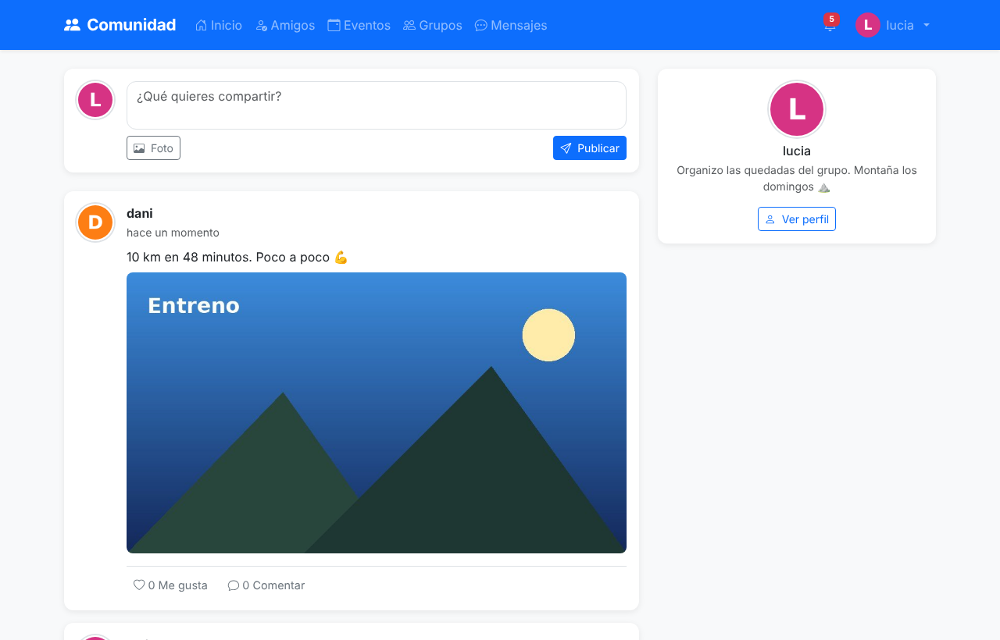
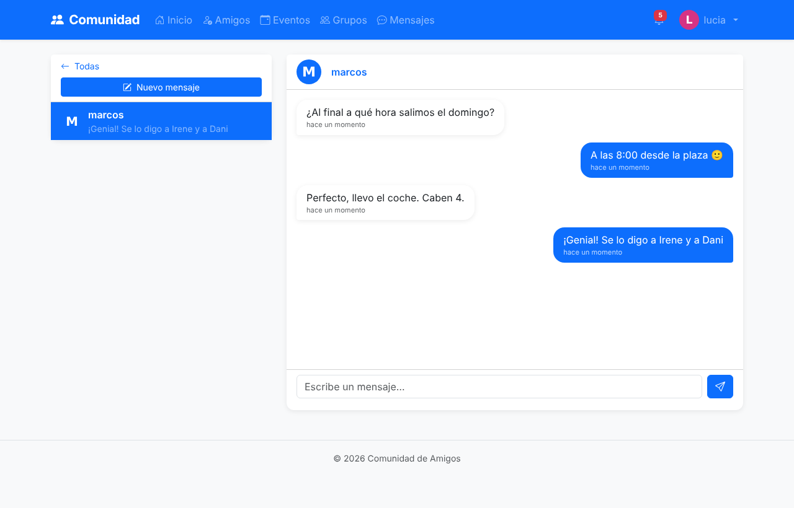
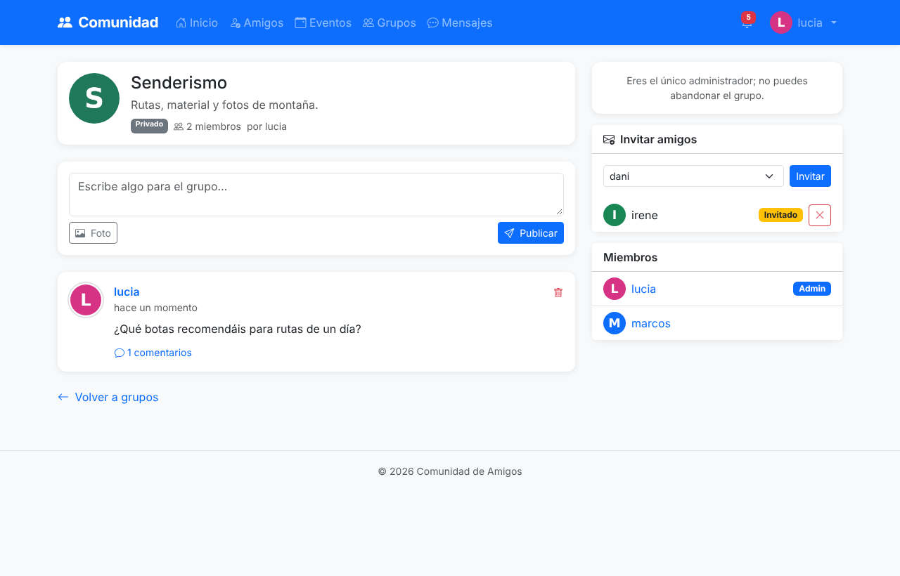
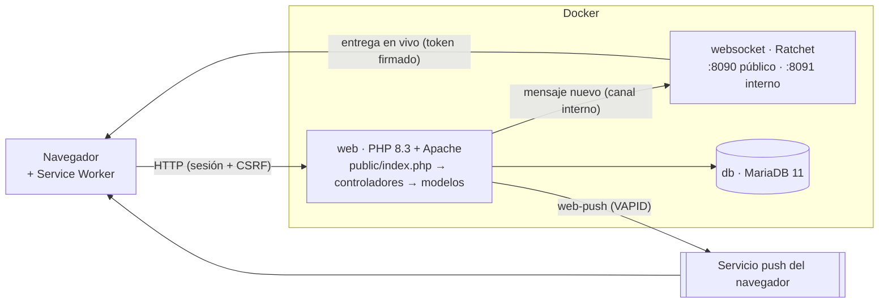

# Comunidad de Amigos

Red social privada para grupos de amigos, hecha en **PHP 8.3 sin framework**, con arquitectura MVC propia, **MariaDB** y **Docker**. Incluye mensajería en tiempo real con **WebSockets**, notificaciones **push** como PWA y eventos con **mapa**.



| Chat en tiempo real | Grupo privado con invitaciones |
|---|---|
|  |  |

## Funcionalidades

- **Cuentas**: red cerrada, sin registro público: las cuentas las crea un administrador. Perfil con avatar y biografía, cambio de contraseña.
- **Feed** con tus publicaciones y las de tus amigos, imágenes, likes y comentarios sin recargar, y aviso de publicaciones nuevas cada 30 segundos.
- **Amistades**: solicitudes, aceptar, rechazar y sugerencias.
- **Eventos** con asistencia (voy, quizás, no voy) y **mapa**: se elige el sitio con un clic y la dirección se rellena sola.
- **Grupos** públicos y privados, con roles, publicaciones y comentarios. Los privados son invisibles para quien no es miembro y se entra **por invitación**.
- **Mensajería privada en tiempo real** (WebSocket) con alternativa por AJAX si el WebSocket no está disponible.
- **Notificaciones** en la web y **push** en el navegador, aunque la pestaña esté cerrada.
- **Panel de administración**: estadísticas, alta de usuarios, activar, desactivar y borrar cuentas, y moderación de publicaciones, comentarios, eventos y grupos.

## Stack

| Pieza | Tecnología | Por qué |
|---|---|---|
| Backend | PHP 8.3 sin framework, MVC propio | Entender lo que un framework hace por debajo: router, autoload, sesión, validación |
| Base de datos | MariaDB 11 + PDO (consultas preparadas reales) | SQL escrito a mano, con `JOIN`, subconsultas y transacciones |
| Vistas | PHP + Bootstrap 5 | HTML generado en servidor; AJAX solo donde recargar molesta |
| Tiempo real | Ratchet (WebSocket) en su propio contenedor | Un chat necesita conexiones largas; Apache trabaja con peticiones cortas |
| Push | Service Worker + Push API + VAPID (`minishlink/web-push`) | Estándar abierto, sin depender de Firebase ni de cuentas de terceros |
| Mapas | Leaflet + OpenStreetMap + Nominatim | Sin API key ni facturación |
| Infraestructura | Docker Compose (web, db, websocket) | `docker compose up` y listo |

## Arquitectura



- Todas las URLs entran por un **front controller** (`app/public/index.php`) con un router de expresiones regulares. Cada controlador exige sesión en su constructor.
- Los mensajes se envían **siempre por HTTP**, donde están la sesión, el CSRF, las notificaciones y el push. Después, la web avisa al servidor WebSocket por un canal interno y este los **empuja** al destinatario.
- Solo `app/public/` es raíz web: la configuración, los modelos y el `.env` no se pueden pedir por URL.

Más detalle en [docs/ARQUITECTURA.md](docs/ARQUITECTURA.md).

## Puesta en marcha

Requisitos: Docker con Docker Compose.

```bash
git clone https://github.com/dredonse/comunidad-amigos.git
cd comunidad-amigos

cp .env.example .env
# Rellena DB_PASS, DB_ROOT_PASS y APP_SECRET (openssl rand -hex 32)

docker compose up -d --build

# Crea el primer administrador (pide usuario, email y contraseña)
docker compose exec web php bin/create-admin.php
```

Abre <http://localhost:8080> y entra con ese email. No hay registro público: el resto de cuentas se crean desde *Administración → Usuarios*.

**Notificaciones push (opcional):** genera las claves, cópialas en `.env` y reinicia.

```bash
docker compose exec web php bin/generate-vapid.php
docker compose up -d
```

**phpMyAdmin (opcional, solo desde tu máquina):** `docker compose --profile tools up -d phpmyadmin` → <http://127.0.0.1:8081>.

**Base de datos ya creada con una versión anterior:** aplica `docker/mysql/migrations/04_seguridad.sql` (las instrucciones están en la cabecera de cada migración).

> El Service Worker y las notificaciones push requieren HTTPS fuera de `localhost`. Para desplegar, pon un proxy inverso con certificado (Nginx, Caddy) delante, cambia `APP_URL` a `https://…` y `WS_PUBLIC_URL` a `wss://…`.

## Seguridad

| Amenaza | Medida |
|---|---|
| Inyección SQL | PDO con consultas preparadas en todas las consultas y `ATTR_EMULATE_PREPARES = false` |
| XSS | Escapado de toda salida (`htmlspecialchars` con `ENT_QUOTES`), `json_encode` con `JSON_HEX_*` hacia JavaScript, `textContent` en el chat y en los mapas |
| CSRF | Token por sesión (`random_bytes`) en todos los POST, comparado con `hash_equals`; cookie `SameSite=Lax`; cierre de sesión por POST |
| Robo o fijación de sesión | Cookie `HttpOnly`, solo por cookie, modo estricto, `session_regenerate_id(true)` al iniciar sesión; `Secure` con HTTPS |
| Cuentas desactivadas | El estado y el rol se comprueban en la base de datos en cada petición |
| Contraseñas | bcrypt (coste 12); la contraseña actual es obligatoria para cambiarla; tiempo de respuesta igual exista o no el email |
| Subida de ficheros | Tipo real por contenido (`finfo`), imagen **re-codificada** con GD (elimina código incrustado y metadatos EXIF/GPS), extensión decidida por el servidor y PHP desactivado en `uploads/` |
| WebSocket | Token firmado con HMAC-SHA256 y caducidad, comprobación de `Origin`, solo recepción |
| Autorización | Comprobación de propiedad en cada borrado; publicaciones visibles solo para amigos; grupos privados ocultos y solo por invitación; sin registro público |
| Configuración | Secretos en `.env`, `display_errors` desactivado, cabeceras de seguridad, SRI en las librerías del CDN, base de datos y phpMyAdmin no expuestos |

En noviembre de 2026 hice una revisión de seguridad del proyecto y encontré, entre otros, dos fallos graves que he corregido: la subida de imágenes permitía **ejecutar código PHP** en el servidor y el servidor WebSocket **aceptaba el identificador de usuario que enviaba el navegador**. El análisis completo, cómo los reproduje y cómo los arreglé están en [docs/SEGURIDAD.md](docs/SEGURIDAD.md).

## Estructura

```
app/
├── bin/            # Scripts de consola: crear administrador, generar claves VAPID
├── config/         # Arranque (entorno, sesión, autoload) y conexión PDO
├── controllers/    # Un controlador por módulo
├── helpers/        # Funciones de seguridad, subidas, push, aviso al WebSocket
├── models/         # Acceso a datos con PDO
├── public/         # Raíz web: index.php (router), .htaccess, JS, CSS, sw.js, manifest
└── views/          # Plantillas PHP
docker/
├── php/            # Imagen web (PHP 8.3 + Apache)
├── websocket/      # Servidor Ratchet
└── mysql/          # init.sql y migraciones
docs/               # Arquitectura, seguridad y diario de desarrollo
```

## Decisiones técnicas

- **Sin framework**, a propósito: el objetivo era aprender a construir las piezas (router, autoload, protección CSRF, gestión de sesión). En un proyecto profesional usaría Laravel o Symfony.
- **Sesión con cookie en lugar de tokens**, porque es una web con formularios y HTML generado en servidor. El precio es tener que protegerse de CSRF.
- **Tiempo real en un proceso aparte** y con la base de datos como fuente de verdad: cada mensaje se guarda antes de entregarse, así que nada se pierde si el WebSocket no está.
- **Un único camino para enviar mensajes** (HTTP). El WebSocket solo empuja del servidor al navegador, así que la validación y la seguridad viven en un sitio.

## Limitaciones conocidas y siguientes pasos

- No hay tests automáticos ni integración continua. Lo siguiente: PHPUnit para los helpers de seguridad y GitHub Actions.
- No hay límite de intentos de inicio de sesión ni Content-Security-Policy.
- El envío de push es síncrono; con más carga iría a una cola.
- Consultas N+1 al cargar comentarios y migraciones de base de datos escritas a mano.
- Pendiente: recuperación de contraseña por email y diseño pensado primero para móvil.

El historial de desarrollo por sesiones está en [docs/DIARIO.md](docs/DIARIO.md).
