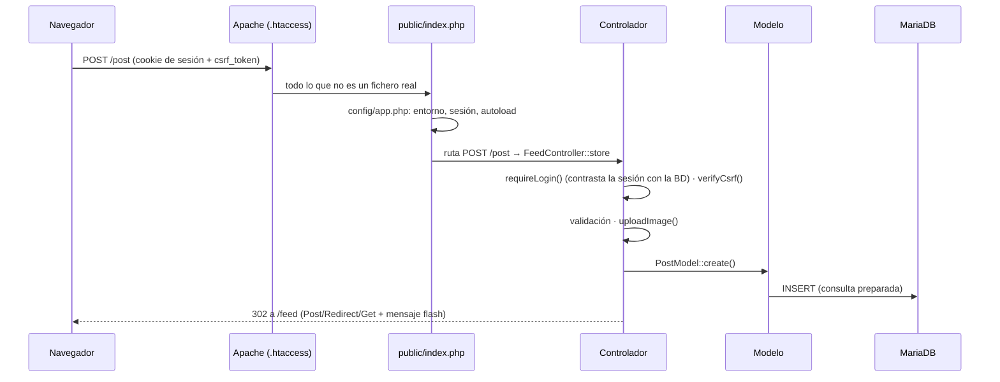

# Arquitectura

## Contenedores

| Servicio | Imagen | Puertos | Función |
|---|---|---|---|
| `web` | PHP 8.3 + Apache (`docker/php/Dockerfile`) | `8080` | La aplicación |
| `db` | MariaDB 11 | ninguno publicado | Base de datos; solo accesible desde la red de Docker |
| `websocket` | PHP 8.3 CLI + Ratchet (`docker/websocket/`) | `8090` público, `8091` interno | Entrega de mensajes en tiempo real |
| `phpmyadmin` | phpMyAdmin (perfil `tools`) | `127.0.0.1:8081` | Herramienta de desarrollo; no arranca por defecto |

MariaDB tiene un *healthcheck* y la web y el WebSocket esperan a que esté sano (`condition: service_healthy`) antes de arrancar.

Las dependencias de Composer de la web se instalan en la imagen, en `/opt/app-deps`, fuera de la carpeta `app/` que se monta como volumen. Así existen también en un clon recién descargado.

## Recorrido de una petición



- **Router** (`app/public/index.php`): tabla de rutas `[método, patrón, controlador, acción]`. El patrón es una expresión regular anclada; los grupos capturados (`/events/(\d+)`) se convierten a entero y se pasan al método.
- **Controladores**: llaman a `requireLogin()` (o `requireAdmin()`) en el constructor, así que ninguna acción nueva puede quedar sin proteger. Cada acción POST empieza por `verifyCsrf()`.
- **Modelos**: solo SQL con PDO. Las operaciones de varias escrituras (crear un evento y apuntar al creador, crear un grupo y hacerle administrador) van en transacción.
- **Vistas**: PHP con Bootstrap. Toda salida pasa por `e()`.

## Mensajería en tiempo real

```mermaid
sequenceDiagram
    participant A as Ana (chat abierto)
    participant W as web (PHP)
    participant S as websocket (Ratchet)
    participant B as Bea
    W-->>A: página del chat con WS_TOKEN = id.caducidad.HMAC
    A->>S: ws://…:8090 · {"type":"auth","token":…}
    S->>S: comprueba Origin, firma y caducidad; usa el id del token
    S-->>A: auth_ok
    B->>W: POST /messages/send (sesión + CSRF)
    W->>W: guarda el mensaje, notificación y push
    W->>S: :8091 (red interna) {"secret":…,"receiver_id":Ana,…}
    S->>A: {"type":"message",…}
    A->>W: POST /messages/read
```

- El navegador **no envía** mensajes por el WebSocket: solo los recibe. Un único camino de envío (HTTP) mantiene la validación, la autorización, las notificaciones y el push en un sitio.
- El token lo firma la web con `APP_SECRET` (`wsToken()` en `app/helpers/functions.php`) y lo verifica Ratchet con el mismo secreto (`ChatServer::verifyToken`). Caduca a las dos horas; recargar la página genera uno nuevo.
- El canal interno (`8091`) no se publica fuera de Docker y además exige el secreto compartido.
- Un usuario puede tener varias pestañas conectadas a la vez.
- El servidor reconecta con MariaDB si la conexión se ha cerrado por inactividad.
- Si el WebSocket no está disponible, el chat sigue funcionando: los mensajes se envían igual y aparecen al recargar.

## Notificaciones

Cada evento social (solicitud de amistad, aceptación, comentario, like, mensaje, invitación o alta en un grupo) genera:

1. Una fila en `notifications`: la campana de la web.
2. Un push al navegador con `minishlink/web-push` y las claves VAPID, si el usuario lo activó. Las suscripciones caducadas se borran solas, y solo se aceptan suscripciones de servicios push conocidos (Google, Mozilla, Microsoft, Apple).

Al cerrar sesión, el navegador borra su suscripción push y las cachés del Service Worker, para que la siguiente persona que use el equipo no reciba notificaciones ajenas.

## PWA

- `manifest.json`: permite instalar la web como aplicación.
- `sw.js`: guarda en caché **solo recursos estáticos** (CSS, JS, imágenes de la interfaz) y una página `offline.html`. Las páginas con datos (feed, mensajes, administración) no se guardan nunca, y además se sirven con `Cache-Control: no-store`.

## Base de datos

14 tablas en `docker/mysql/init.sql` (InnoDB, `utf8mb4`). Lo más relevante:

- **`friends`**: una fila por relación con estado `pending`/`accepted`. Rechazar borra la fila.
- **`group_members`**: rol (`admin`/`member`) y estado (`approved`/`invited`). Los grupos privados son invisibles para quien no es miembro y se entra por invitación.
- **Claves únicas** como reglas de negocio: un like por usuario y post, una respuesta por usuario y evento, un miembro por grupo.
- **`ON DELETE CASCADE`** en todas las claves foráneas. Al borrar un usuario, la aplicación borra también sus imágenes del disco.
- El esquema de bases de datos existentes se actualiza con los ficheros de `docker/mysql/migrations/`.

## Scripts de consola

| Script | Para qué |
|---|---|
| `php bin/create-admin.php` | Crear el primer administrador o ascender un usuario existente. No hay usuarios por defecto ni registro público: las demás cuentas se crean desde el panel |
| `php bin/generate-vapid.php` | Generar las claves VAPID para las notificaciones push |
